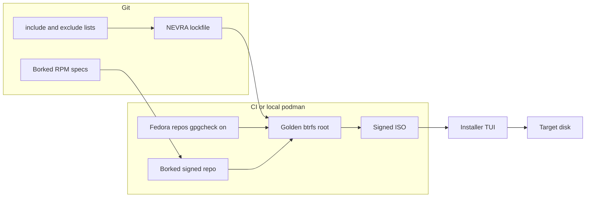

# Borked OS — Beautifully broken.

A Fedora remix with the COSMIC desktop, your package set, and an installer that unpacks a prebuilt system the way [Omarchy](https://github.com/omacom/omarchy-iso) does. This file is the build contract. Do not start implementing from anywhere else.

## Decision

Ship a **mutable Fedora remix**, not an atomic/bootc image and not an Anaconda reskin.

- **Base:** Fedora **45**. Confirmed 2026-11-06: the Fedora 45 metalink responds and `quay.io/fedora/fedora:45` exists. Consume Fedora repos with `gpgcheck=1`. Never re-sign or rehost Fedora RPMs.
- **Desktop:** official `@cosmic-desktop` is always in the image. The installer also offers **Hyprland** as a session choice. Hyprland and a small stack (`waybar`, `wofi`, `hyprpaper`, `hyprlock`, `hypridle`, `xdg-desktop-portal-hyprland`) come from the `nett00n/hyprland` COPR (`repos/hyprland.repo`, `gpgcheck=1`, priority 110). Both sessions ship in one golden root; the installer seeds `cosmic-greeter`'s per-user `last_session` so login opens the chosen desktop. Confirmed against Fedora 45 comps: the group id is `cosmic-desktop`, not `cosmic-desktop-environment`. `cosmic-desktop-apps` is supplementary and is not part of the skeleton. Fedora already ships COSMIC and a [COSMIC spin](https://fedoraproject.org/spins/cosmic/). Hyprland itself is not in Fedora; do not vendor its RPMs.
- **Greeter:** `cosmic-greeter.service` is the display manager for both desktops. Its `ExecStart` is `greetd --config /etc/greetd/cosmic-greeter.toml`. `[Install]` aliases it to `display-manager.service`. Also enable `cosmic-greeter-daemon.service` (`WantedBy=multi-user.target`). The greeter unit `Wants=` the daemon. Session `.desktop` files live under `/usr/share/wayland-sessions/` (`COSMIC`, `Hyprland`).
- **Boot packages:** Fedora 45 names are `grub2-efi-x64` and `shim-x64`.
- **Your packages:** a small Borked RPM repo (release metadata, repo file, defaults, anything Fedora does not ship the way you want). Higher priority than Fedora, only for packages you actually replace.
- **Install speed:** at ISO build time, install the locked package set once into a btrfs subvolume. The ISO carries a `btrfs send` stream. The installer receives it onto the target disk, then does per-machine work only (user, hostname, bootloader, machine-id). Fedora’s generic `kernel` plus both microcode packages can live in the image, so there is no Arch-style per-CPU package delta.
- **Trust:** public build, locked NEVRAs, signed ISO, SELinux enforcing, Fedora Secure Boot via stock shim and the Fedora-signed kernel. Not an immutable OS. Rollback is btrfs snapshots, added after the installer works.

Atomic COSMIC (`quay.io/fedora-ostree-desktops/cosmic-atomic`, bootc) is a better fit for image rollback, and a worse fit for “here is the list of packages I want and don’t want” plus a sub-minute unpack install. Nobara’s model (fork and rehost Fedora, disable SELinux, `gpgcheck=0` in places) is the one to avoid.

## What “trusted” means in v1

Do not claim bit-for-bit reproducible RPMs. Claim this, and test it:

- Every Fedora package is verified with Fedora’s keys during the image build.
- The image installs only what [`packages/lock`](packages/lock) names. The lock is generated from your lists and committed.
- [`os-release`](branding/os-release) says `ID=borked`, `ID_LIKE=fedora`, `VARIANT="COSMIC"`. `PRETTY_NAME="Borked OS"`. Tagline lives in branding, not in the legal ID.
- SELinux stays **enforcing**. No Nobara-style `selinux --disabled`.
- v1 kernel is Fedora’s signed kernel, so Secure Boot works without a custom Machine Owner Key. No custom kernel in v1.
- The ISO publishes `SHA256SUMS` and a detached signature. Dev builds set `VARIANT=Development` and are unsigned.
- A public SBOM (SPDX, via syft) is attached to each release.
- First boot does not phone home.
- RPM Fusion, NVIDIA, and full patent-encumbered codecs are **opt-in later**, not in the base image. The base trust root is Fedora plus the Borked signing key.

Out of band: you hold the release key. Implementation must not generate a long-term private key into git. Document the fingerprint in the README once the key exists.

Legal: this is a Fedora Remix. The name is Borked OS. Docs may say “based on Fedora.” Do not use the Fedora logo or imply Red Hat or System76 ship this. COSMIC is the default desktop; Hyprland is an optional session from a third-party COPR.

## Repository layout

One repo. `just` is the only entry point an agent should need.

- [`AGENTS.md`](AGENTS.md) — rules below, written so a later agent does not re-decide architecture.
- [`release/fedora`](release/fedora) — one integer, the pinned Fedora release. Start with `45`.
- [`packages/include.list`](packages/include.list) — one name or `@group` per line. Comments with `#`.
- [`packages/exclude.list`](packages/exclude.list) — names that must not appear in the solved transaction, even as dependencies. If an include pulls one in, the build fails.
- [`packages/lock`](packages/lock) — generated. `name-epoch:version-release.arch` plus the Fedora compose URL and repo metadata checksums used to solve it.
- [`specs/`](specs/) — `borked-release`, `borked-repos`, `borked-defaults` (RPM specs, built with mock).
- [`branding/`](branding/) — os-release snippet, issue, COSMIC theme seed, wallpaper, grub theme later.
- [`image/build-root.sh`](image/build-root.sh) — runs inside `fedora:${RELEASE}` via podman. Produces `out/borked-root.btrfs.zst` (a `btrfs send --compressed-data` stream).
- [`installer/`](installer/) — Python 3 TUI, stdlib plus one TUI library if needed. Phases are separate modules.
- [`iso/build-iso.sh`](iso/build-iso.sh) — small live system + the root stream + installer, assembled into a hybrid BIOS/UEFI ISO.
- [`ci/test-install.py`](ci/test-install.py) — unattended qemu install, then boot the disk and assert `ID=borked` and that COSMIC’s greeter is enabled.
- [`justfile`](justfile) — `just lock`, `just root`, `just iso`, `just qemu`, `just test`.

You fill the two lists. Until then, the only includes are a bootable skeleton: `@core`, `kernel`, `kernel-modules`, `linux-firmware`, `microcode_ctl`, `grub2-efi-x64`, `shim-x64`, `efibootmgr`, `btrfs-progs`, `NetworkManager`, `pipewire`, `wireplumber`, `selinux-policy-targeted`, `@cosmic-desktop`, and the three `borked-*` packages. No guessed apps. `selinux-policy-targeted` is on the skeleton because `install_weak_deps=False` will not pull the policy in by itself, and v1 must boot enforcing.

## Package rules

- Agent edits **lists**, then runs `just lock`. It does not hand-edit the lock except to delete it and regenerate.
- `just lock` uses `dnf install --assumeno` / `dnf repoquery` inside the Fedora container against Fedora `fedora` + `updates` and the local Borked repo. `install_weak_deps=False` so the image stays the list you wrote.
- Excludes are enforced twice: passed as `dnf --exclude`, and checked after the solve. A hit is a hard error that names the package that pulled it in.
- Replacing a Fedora package (same name, Borked build) requires a one-line reason in [`packages/replacements.md`](packages/replacements.md). If there is no reason, the spec does not get built.
- v1 arch is **x86_64 only**.

## Image build

Inside podman (`fedora` matching [`release/fedora`](release/fedora)):

1. Create a sparse loop file, `mkfs.btrfs`, mount with `compress-force=zstd:3`.
2. `dnf --installroot` the locked set. `gpgcheck=1`. Releasever pinned. No `updates-testing`.
3. Run the `borked-*` scriptlets: write `/etc/os-release`, enable `cosmic-greeter.service`, `cosmic-greeter-daemon.service`, and `NetworkManager`, mask nothing surprising, leave `/etc/machine-id` empty (systemd treats an empty file as uninitialized), empty `/var/log`, `dnf clean all`.
4. Set the default target to `graphical.target`. Do not set a root password; the installer creates the user and locks root the way Fedora does (`root` locked, user in `wheel`).
5. Unmount, `btrfs send --compressed-data`, zstd the stream only if send compression is not enough. Record the stream checksum in `out/manifest.json` (lock hash, Fedora release, package count, stream sha256).

`graphical.target` wants `display-manager.service`. Enabling `cosmic-greeter.service` creates that alias.

Host note, confirmed on this machine: rootless podman cannot `losetup` even with `--privileged` (`Permission denied` on loop-control). The script still belongs in the Fedora container. On a rootless host, run the mount and `btrfs send` inside a Fedora qemu guest where the disk is a real virtio block device, or on a rootful podman/VM host. Do not drop btrfs send because of that.

Regenerate the initramfs with `hostonly=no` so the golden image is not bound to the build machine’s devices. Installer runs `restorecon` in the target chroot. Do not rely on `/.autorelabel` for the qemu self-check; that path reboots before the check can run.

Local iteration does not need an ISO. `just qemu` writes the stream into a raw disk with a simple ESP and boots it.

## Installer

Boots to a TUI on tty1. No Anaconda. Live userspace is only large enough to partition, decrypt, receive, and install the bootloader. Optional “try COSMIC” live session is out of v1 (it doubles the ISO and is not what makes Omarchy fast).

Questions, in one pass: desktop (COSMIC or Hyprland), disk, optional LUKS passphrase, username, full name, password, hostname, timezone. Keyboard defaults to the console layout. A `cidata` volume with a JSON config skips the TUI for qemu and later automation (same idea as Omarchy’s unattended drive). Unattended configs may set `"desktop": "cosmic"` or `"desktop": "hyprland"`; default is `cosmic`.

Default layout, UEFI:

- ESP, FAT32, 1 GiB, mounted at `/boot/efi`
- When LUKS is requested, a 1 GiB unencrypted ext4 `/boot` partition so Fedora's signed GRUB can boot an Argon2id LUKS2 root
- One LUKS2 container if requested, then one btrfs
- Subvolume `@` receives the stream; `@home` is created empty

Then: new btrfs UUID (mkfs already allocates one; `btrfs receive` keeps the target filesystem UUID, unlike `dd` of a partition image), resize to the partition, `systemd-machine-id-setup`, write `/etc/hostname`, `/etc/localtime`, create the user with `wheel`, install GRUB via `shim` so Secure Boot still chains to Fedora’s kernel, regenerate the initramfs if the received one does not match this machine’s firmware set. Offline install must work with no network.

`btrfs receive` creates `@` read-only. Set it writable before the installer writes fstab, the user, and the bootloader. Copy `shimx64.efi` to `EFI/BOOT/BOOTX64.EFI` so qemu OVMF and removable-media machines boot without an existing NVRAM entry.

Target to measure in qemu and record in the README: unpack-dominated install, interactive path under a few minutes on NVMe, and the package transaction is not on that path.

## Branding packages

Three specs, built with mock against the pinned Fedora:

- `borked-release` — `/etc/os-release`, `/etc/issue`, `/usr/lib/os-release`, system name. Tagline `Beautifully broken.` goes in `/etc/issue`, not in `ID`.
- `borked-repos` — `/etc/yum.repos.d/borked.repo` pointing at the versioned repo URL, `gpgcheck=1`, `priority=90` (preferred over Fedora’s 99), and `/etc/pki/rpm-gpg/RPM-GPG-KEY-borked`. Until a host exists, `skip_if_unavailable=1` and a placeholder baseurl such as `https://repo.borked.invalid/45/x86_64`.
- `borked-defaults` — COSMIC theme seed and wallpaper under `/usr/share`, plus any `/etc` defaults you actually want. No dotfiles dumped into `/etc/skel` beyond what you list later.

Repo publishing: `createrepo_c` in CI, packages signed with the release key, static files on a host you control. The repo is split by Fedora release (`…/45/x86_64`). Do not mirror Fedora.

Dev signing: generate a key under `out/keys/` at build time if the release key is absent. Gitignore `out/` and never commit a private key. The public half is what the dev RPM embeds. Release signing waits until you supply a key.

## Build, test, release

Host can be any distro with podman and qemu. The build itself runs in the Fedora container.

Each push that changes lists, specs, installer, or image scripts:

1. `just lock` if lists changed (fail if the lock is stale).
2. `just root`
3. `just iso`
4. Unattended qemu install from the ISO, boot the resulting disk, read `/etc/os-release`, check `getenforce` would be Enforcing (policy present, config not permissive), check `systemctl is-enabled cosmic-greeter.service`, check every exclude is absent (`rpm -q`).

A release is a tagged git commit, the ISO, `SHA256SUMS`, signature, SBOM, and `manifest.json`. Nothing publishes if qemu failed.

Ship `/usr/bin/borked-selfcheck` in `borked-release`. It checks `ID=borked`, `SELINUX=enforcing`, the greeter enabled, `graphical.target` as default, and that every name in `/usr/share/borked/exclude.list` is absent. Qemu invokes it with `systemd.run=/usr/bin/borked-selfcheck` and `systemd.run_success_action=poweroff`. The script writes the result to the serial console and to the ESP so the host can read it after poweroff.

## Implementation order

Work in this order so each step boots before the next one starts.

1. **Skeleton and contract.** `AGENTS.md`, `justfile`, `release/fedora`, empty-but-valid list format, podman wrapper. Fedora 45, `@cosmic-desktop`, and `cosmic-greeter.service` are already confirmed. Re-check only if `release/fedora` changes.
2. **Golden root.** `image/build-root.sh` plus `just qemu` to a graphical boot of stock COSMIC with `ID=borked` once `borked-release` exists. Skeleton package list only.
3. **Borked RPMs.** The three specs, local createrepo, wired into the root build.
4. **Installer and ISO.** Partition, LUKS, `btrfs receive`, user, GRUB/shim. Unattended JSON path first, TUI second, so qemu can test before the UI is pretty.
5. **Lockfile enforcement and exclude tests.** A fixture exclude that the skeleton does not need (`nginx`), plus a negative test that a bad exclude fails the solve (include `bash`, exclude `glibc`).
6. **CI.** qemu test on a runner that can do KVM or TCG. Publish unsigned dev ISOs first. Signing is a follow-up once you have a key.
7. **Your package list.** You paste include/exclude. Agent only updates lists, regenerates the lock, and fixes solve failures. No drive-by apps.
8. **After v1.** Snapper on `@` with a `dnf` pre-transaction snapshot. Optional installer toggles for a media profile. Website and a one-page trust doc that repeats the threat model: users trust Fedora’s keys and the Borked key, and they can rebuild the package set from git.

## Agent rules to put in AGENTS.md

- Do not switch the project to Arch, atomic, Anaconda, or a custom kernel unless the plan is changed first.
- Do not disable SELinux, `gpgcheck`, or Secure Boot shim.
- Do not add packages except through `packages/include.list`.
- Do not vendor Fedora package payloads.
- Dev builds stay marked Development.
- After image or installer changes, `just qemu` or `just test` is the definition of done. A script that exits 0 without a booted VM is not done.
